# Scitizia: 55 low poly characters with skeleton and animations, in glTF/GLB with a retro 32-bit look

🇬🇧 English · **🇧🇷 [Leia em português](README.md)**


https://github.com/user-attachments/assets/58f36ce6-06f5-473f-8c92-55f8929fcd20

▶️ **[Watch the video on YouTube](https://www.youtube.com/watch?v=Bqv8QLAiDzU)** · **[Download on itch.io](https://kkyqr.itch.io/scitizia-people)** (free, optional donation)

**Scitizia: people** is a free collection of 55 low poly characters with the retro look of 32-bit games, ready for real-time games: 31 named characters (story characters, co-drivers and drivers) and 24 crowd variations. Each character is a binary glTF 2.0 file (`.glb`) of 231 to 378 KB with **one continuous skinned mesh** of 1,058 to 1,806 triangles, the **same 19-bone humanoid skeleton** in all of them (A-pose at rest, up to 4 bones per vertex), a 256×512 px texture painted by code, with face, clothes and hair in pixels, baked light and shadow and "nearest" filtering, and **10 looping animations** on the skeleton: idle, walk, run, push, cheer, wave, jump, sit, crowd cheer, point. The characters were made for the game **Scitizia Rally Championship**; names, faces and clothes are made up, with no brand, logo or real person.

## Summary

| | |
|---|---|
| Characters | 55: story characters 10, co-drivers 5, drivers 16, crowd 24 |
| Format | binary glTF 2.0 (`.glb`), texture also as PNG |
| Mesh | one continuous skinned mesh (no loose parts at the joints), 1,058 to 1,806 triangles (average 1,438); hair, nose, ears and accessories attached to the head in the same mesh |
| Skeleton | 19 bones, the same in all of them, A-pose at rest, up to 4 bones per vertex |
| Animations | 10 looping clips on the skeleton, sampled at 15 frames per second |
| Texture | 256×512 px per character, "nearest" filtering (crisp pixels), baked light and occlusion; the bottom half has the face at high resolution and eye and mouth frames for expressions (blinking, talking, smiling) |
| Expressions | cast (31): 4 morph targets on the mesh (`boca` opens the jaw, `sorriso`, `sobrancelha` raises the eyebrow, `franze`), names in `extras.targetNames`; the crowd has none |
| Size | 231 to 378 KB per file |
| Scale and axes | meters, Y up, facing +Z, origin on the ground between the feet, 1.57 to 1.94 m tall (with hair and hat) |
| Machine-readable catalog | [`catalogo.json`](catalogo.json) |
| License | public domain, [CC0 1.0](LICENSE) |

## Animations

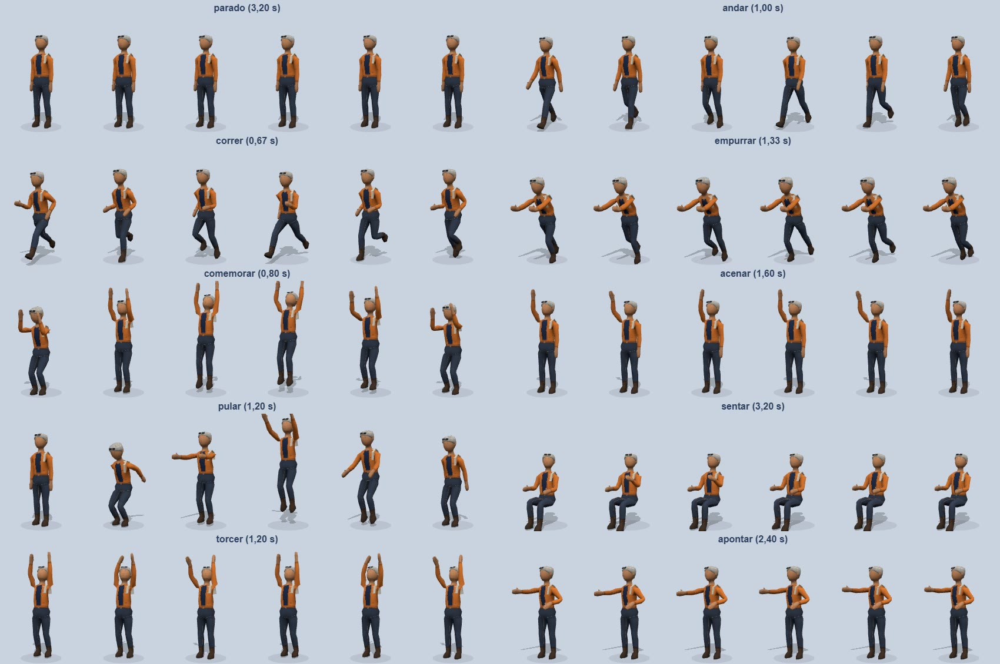

| Clip | Duration | What it does |
|---|---|---|
| `parado` | 3.20 s | standing still breathing, shifts weight between legs and looks around |
| `andar` | 1.00 s | walk cycle in place (1.37 m per cycle: 1.37 m/s) |
| `correr` | 0.67 s | run in place (2.2 m per cycle: 3.3 m/s) |
| `empurrar` | 1.33 s | pushing a car with both hands, taking short steps (0.75 m/s) |
| `comemorar` | 0.80 s | jumping with arms up |
| `acenar` | 1.60 s | waving with the right hand |
| `pular` | 1.20 s | crouches, jumps and lands in place |
| `sentar` | 3.20 s | seated (seat at ~0.45 m), gesturing and looking around |
| `torcer` | 1.20 s | cheering with arms up, bouncing |
| `apontar` | 2.40 s | pointing forward with the right hand, the other on the hip |

All the clips animate the rotation of every bone (and the position of `Quadril`), so switching from one to another never leaves a leftover pose. Walk, run and push are done in place: move the character through the game at the indicated speed.

## Story characters

The mentor, the rival, the radio host, the team bosses, the rival team owner, the head mechanic and the smallholder at the farm gate. 10 characters.

| Preview (front and 3/4) | Character | Triangles | Size |
|---|---|---|---|
| 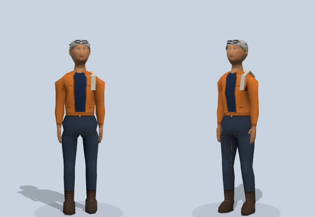 | **Zélia Brandão**<br>`zelia`<br>Mentor, head of Oficina Brandão: open orange jacket over a navy blue T-shirt, jeans, boots, short gray hair, glasses on her forehead, rag on her shoulder.<br>[poses](previas/zelia_poses.jpg) | 1,750 | 367.6 KB |
| 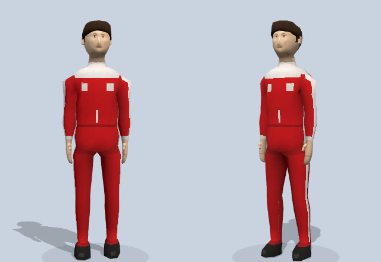 | **Breno Cardim**<br>`breno`<br>Rival driver: red racing suit with white stripes, shoes, chestnut quiff.<br>[poses](previas/breno_poses.jpg) | 1,570 | 331.2 KB |
| 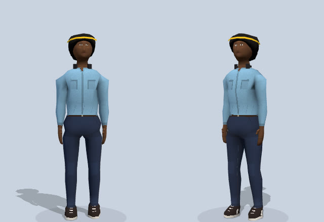 | **Lu Arantes**<br>`lu`<br>Radio host: light blue button-up shirt, jeans, sneakers, dark curly hair, headband, headphones around her neck.<br>[poses](previas/lu_poses.jpg) | 1,726 | 343.8 KB |
| 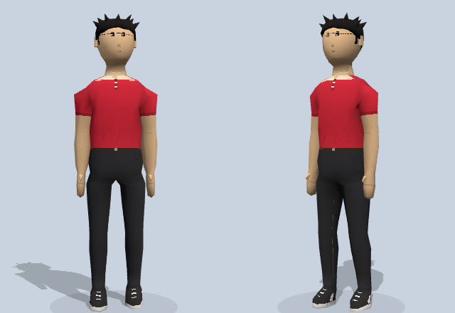 | **Rafa Okumura**<br>`rafa`<br>Head of a young drivers program: red polo shirt with a beige collar, navy blue dress pants, sneakers, spiky dark hair, glasses.<br>[poses](previas/rafa_poses.jpg) | 1,614 | 330.6 KB |
| 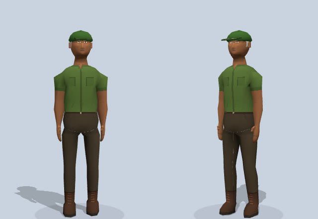 | **Tião Mourão**<br>`tiao`<br>Founder of a collective of independent drivers: green short-sleeved button-up shirt, brown dress pants, boots, mustache, cap.<br>[poses](previas/tiao_poses.jpg) | 1,558 | 326.2 KB |
| 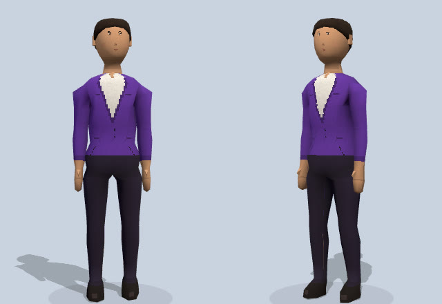 | **Marta Quintela**<br>`marta`<br>Team director: purple blazer over a white shirt, purple dress pants, shoes, dark bun.<br>[poses](previas/marta_poses.jpg) | 1,606 | 332.4 KB |
| 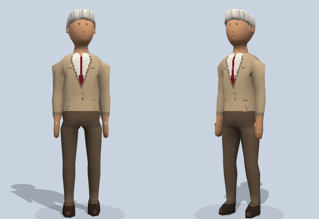 | **Augusto Cardim**<br>`cardim`<br>Rival team owner: beige blazer with a burgundy tie, brown dress pants, shoes, white quiff, mustache.<br>[poses](previas/cardim_poses.jpg) | 1,570 | 332.8 KB |
| 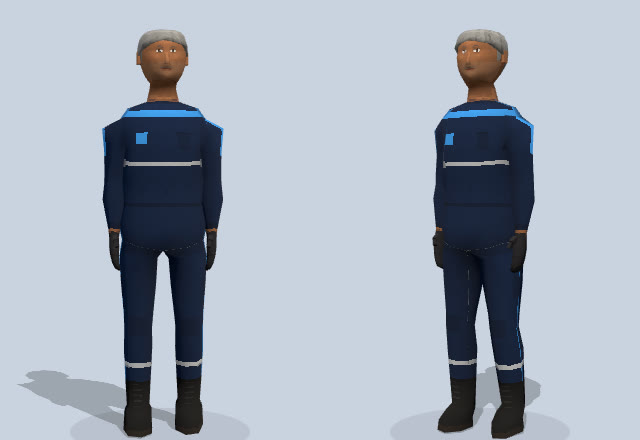 | **Dito**<br>`dito`<br>Head mechanic: navy blue team overalls with blue stripes, boots, gloves, short gray hair, mustache.<br>[poses](previas/dito_poses.jpg) | 1,570 | 309.7 KB |
| 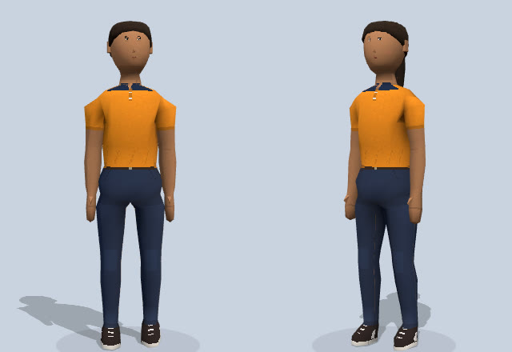 | **Rosa**<br>`rosa`<br>Team boss: orange polo shirt with a navy blue collar, jeans, sneakers, dark ponytail.<br>[poses](previas/rosa_poses.jpg) | 1,630 | 333.8 KB |
| 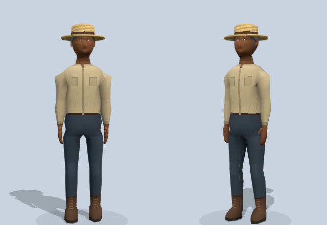 | **Seu Bento**<br>`bento`<br>Smallholder at the farm gate: beige button-up shirt, jeans, boots, straw hat.<br>[poses](previas/bento_poses.jpg) | 1,702 | 338.0 KB |

## Co-drivers

The five co-drivers, in team overalls and headsets. 5 characters.

| Preview (front and 3/4) | Character | Triangles | Size |
|---|---|---|---|
| 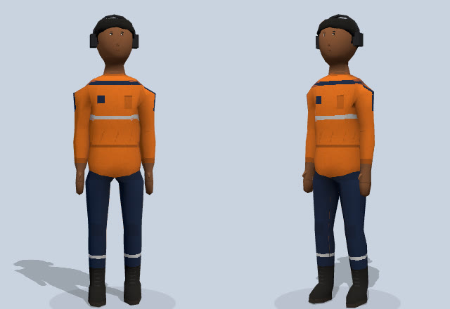 | **Caetano Brito**<br>`caetano`<br>Co-driver: orange team overalls with navy blue stripes, boots, short dark hair, headset.<br>[poses](previas/caetano_poses.jpg) | 1,690 | 340.4 KB |
| 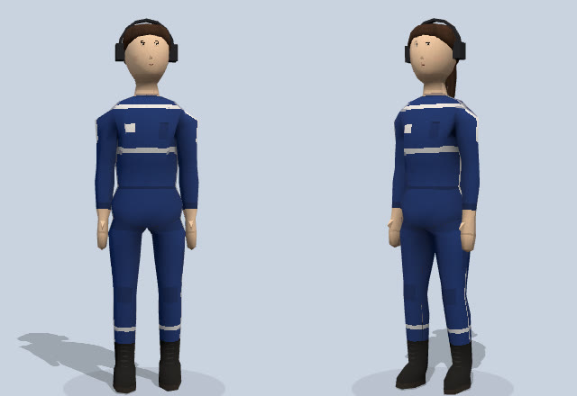 | **Inês Valadares**<br>`ines`<br>Co-driver: navy blue team overalls with white stripes, boots, chestnut ponytail, headset.<br>[poses](previas/ines_poses.jpg) | 1,750 | 360.3 KB |
| 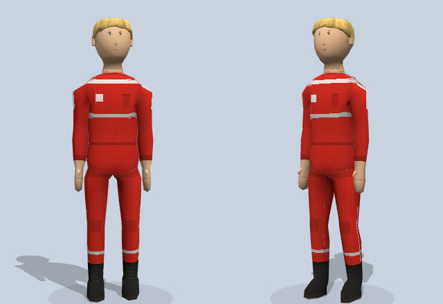 | **Cody Harlan**<br>`cody`<br>Co-driver: red team overalls with white stripes, boots, short blond hair.<br>[poses](previas/cody_poses.jpg) | 1,570 | 338.4 KB |
| 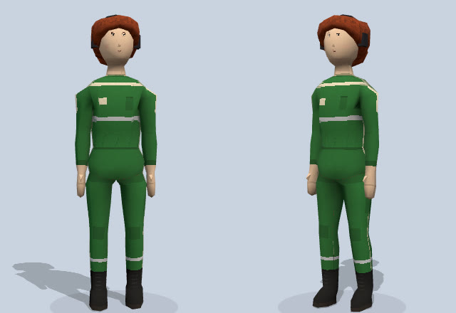 | **Fiona Ashworth**<br>`fiona`<br>Co-driver: green team overalls with beige stripes, boots, chestnut curly hair, headset.<br>[poses](previas/fiona_poses.jpg) | 1,726 | 363.3 KB |
| 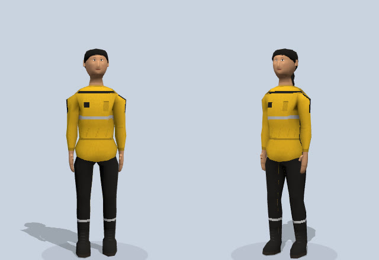 | **Lucía Moraleda**<br>`lucia`<br>Co-driver: yellow team overalls with black stripes, boots, dark braid.<br>[poses](previas/lucia_poses.jpg) | 1,726 | 330.4 KB |

## Drivers

The player's 16 driver avatars, in racing suits, with varied faces, ages, skin tones and hairstyles. Since the 11/24/2026 version, the drivers' faces are painted in full (shading, lips and beard in the texture itself), from AI-generated portraits adjusted to the face frame; big cartoon-style eyes and expression frames (talking, laughing, surprised, angry). 16 characters.

| Preview (front and 3/4) | Character | Triangles | Size |
|---|---|---|---|
| 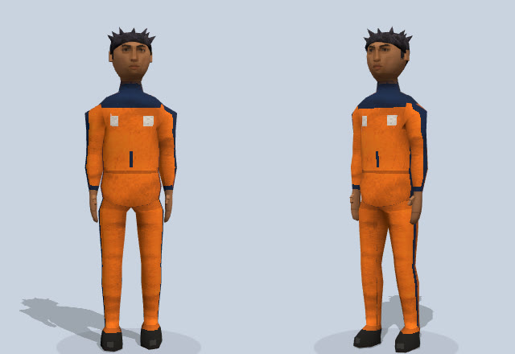 | **Driver H01**<br>`piloto_h01`<br>Driver avatar (man, 22 years old): orange racing suit with navy blue stripes, shoes, spiky dark hair.<br>[poses](previas/piloto_h01_poses.jpg) | 1,614 | 371.9 KB |
| 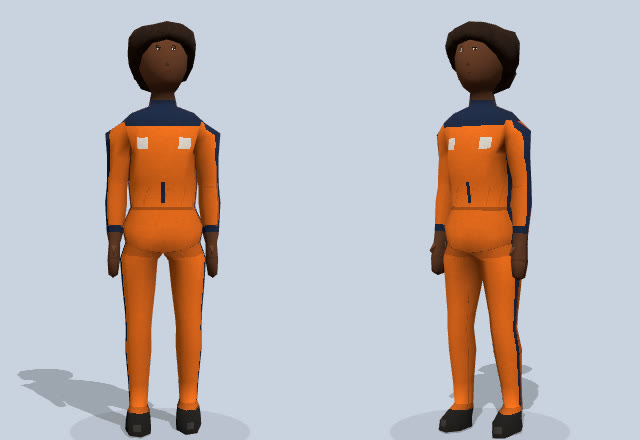 | **Driver M01**<br>`piloto_m01`<br>Driver avatar (woman, 25 years old): orange racing suit with navy blue stripes, shoes, dark curly hair.<br>[poses](previas/piloto_m01_poses.jpg) | 1,686 | 366.9 KB |
| 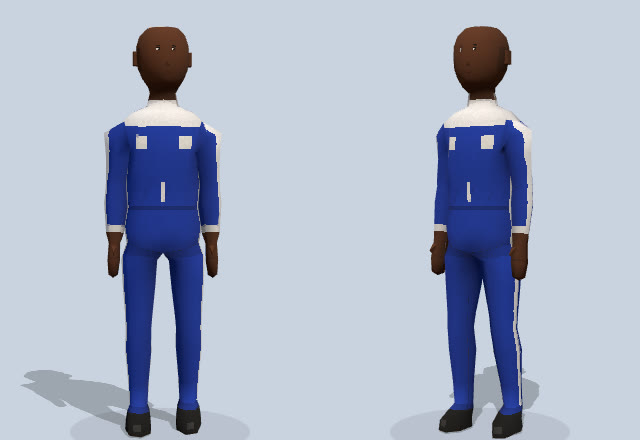 | **Driver H02**<br>`piloto_h02`<br>Driver avatar (man, 30 years old): blue racing suit with white stripes, shoes, bald.<br>[poses](previas/piloto_h02_poses.jpg) | 1,462 | 339.8 KB |
| 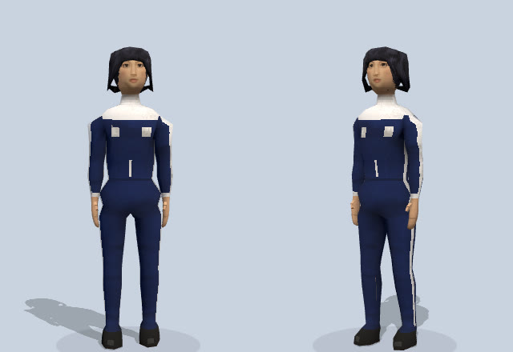 | **Driver M02**<br>`piloto_m02`<br>Driver avatar (woman, 34 years old): navy blue racing suit with white stripes, shoes, dark bob.<br>[poses](previas/piloto_m02_poses.jpg) | 1,570 | 354.7 KB |
| 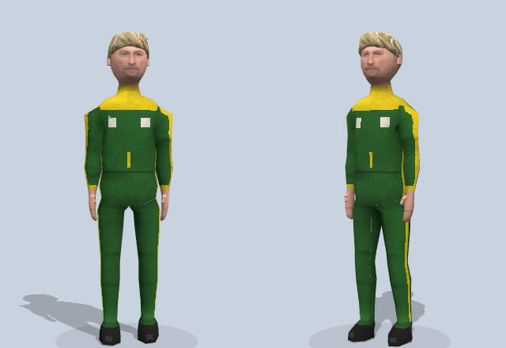 | **Driver H03**<br>`piloto_h03`<br>Driver avatar (man, 45 years old): green racing suit with yellow stripes, shoes, blond quiff, beard.<br>[poses](previas/piloto_h03_poses.jpg) | 1,570 | 372.5 KB |
| 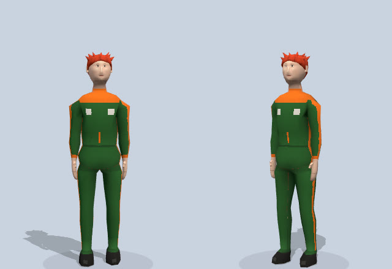 | **Driver M03**<br>`piloto_m03`<br>Driver avatar (woman, 48 years old): green racing suit with orange stripes, shoes, long red hair.<br>[poses](previas/piloto_m03_poses.jpg) | 1,570 | 371.8 KB |
| 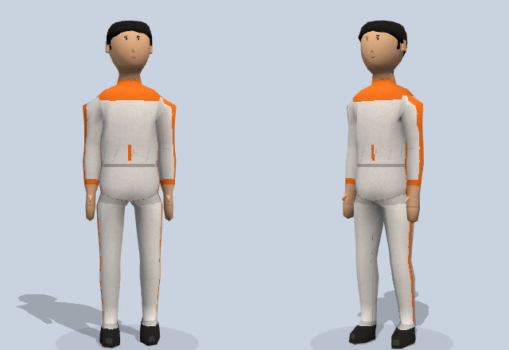 | **Driver H04**<br>`piloto_h04`<br>Driver avatar (man, 27 years old): white racing suit with orange stripes, shoes, short dark hair.<br>[poses](previas/piloto_h04_poses.jpg) | 1,570 | 362.5 KB |
| 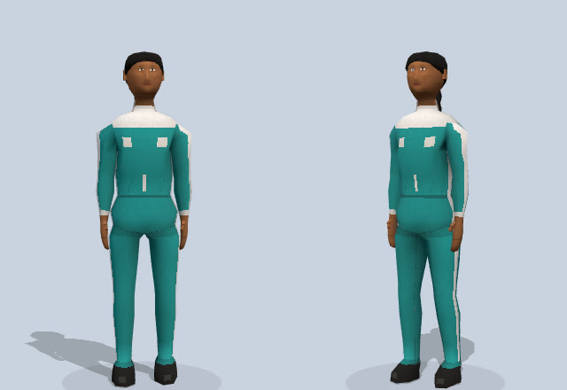 | **Driver M04**<br>`piloto_m04`<br>Driver avatar (woman, 29 years old): blue racing suit with white stripes, shoes, dark braid.<br>[poses](previas/piloto_m04_poses.jpg) | 1,806 | 371.7 KB |
| 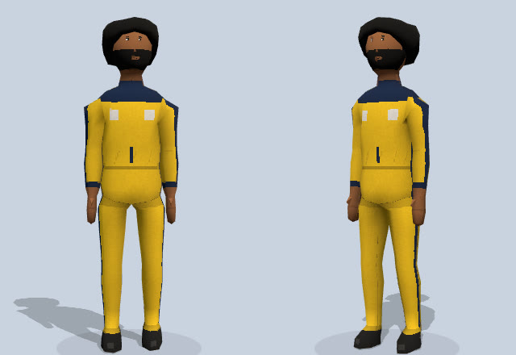 | **Driver H05**<br>`piloto_h05`<br>Driver avatar (man, 38 years old): yellow racing suit with navy blue stripes, shoes, dark curly hair, beard.<br>[poses](previas/piloto_h05_poses.jpg) | 1,570 | 360.0 KB |
| 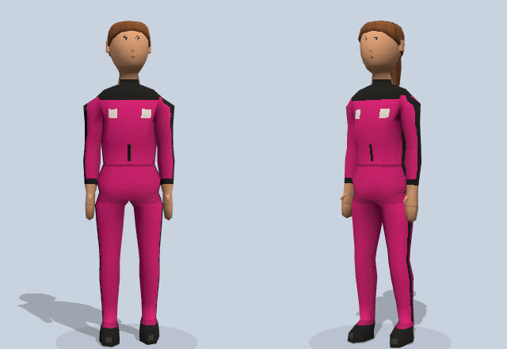 | **Driver M05**<br>`piloto_m05`<br>Driver avatar (woman, 22 years old): pink racing suit with black stripes, shoes, chestnut ponytail.<br>[poses](previas/piloto_m05_poses.jpg) | 1,710 | 375.4 KB |
| 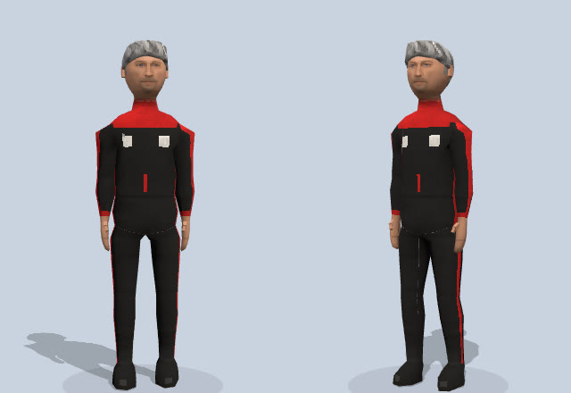 | **Driver H06**<br>`piloto_h06`<br>Driver avatar (man, 56 years old): black racing suit with red stripes, shoes, gray quiff, beard.<br>[poses](previas/piloto_h06_poses.jpg) | 1,570 | 349.4 KB |
| 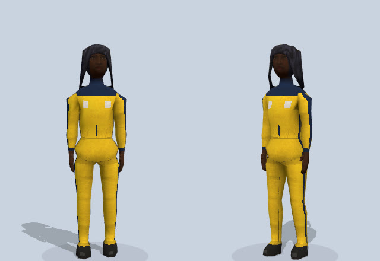 | **Driver M06**<br>`piloto_m06`<br>Driver avatar (woman, 41 years old): yellow racing suit with navy blue stripes, shoes, long dark hair.<br>[poses](previas/piloto_m06_poses.jpg) | 1,570 | 342.2 KB |
| 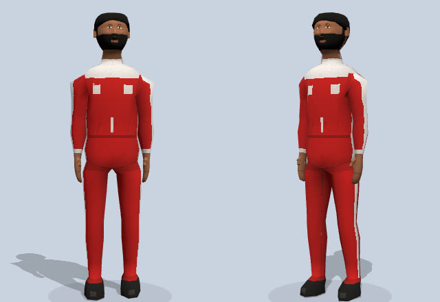 | **Driver H07**<br>`piloto_h07`<br>Driver avatar (man, 33 years old): red racing suit with white stripes, shoes, short dark hair, beard.<br>[poses](previas/piloto_h07_poses.jpg) | 1,570 | 360.0 KB |
| 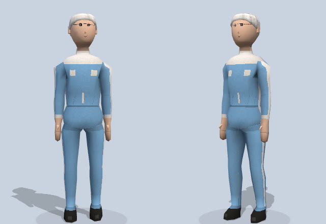 | **Driver M07**<br>`piloto_m07`<br>Driver avatar (woman, 58 years old): light blue racing suit with white stripes, shoes, white bun, glasses.<br>[poses](previas/piloto_m07_poses.jpg) | 1,686 | 378.3 KB |
| 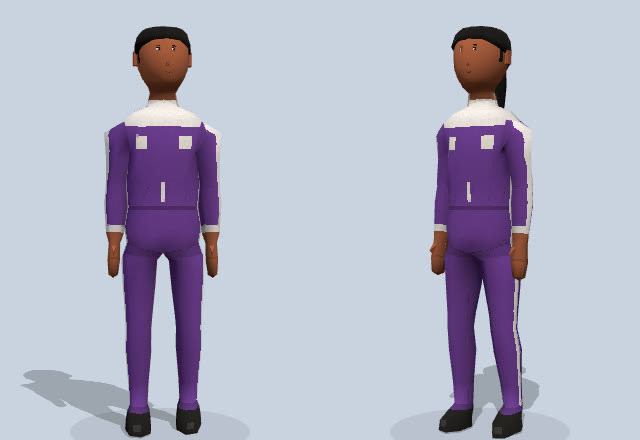 | **Driver H08**<br>`piloto_h08`<br>Driver avatar (man, 24 years old): purple racing suit with white stripes, shoes, dark ponytail.<br>[poses](previas/piloto_h08_poses.jpg) | 1,630 | 361.6 KB |
| 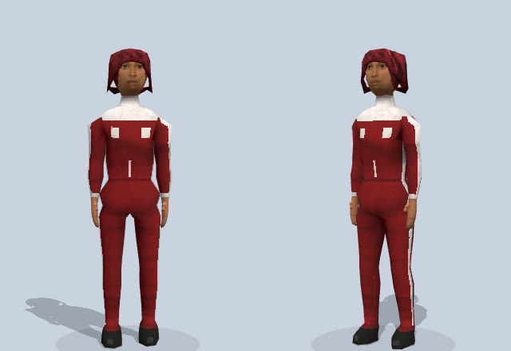 | **Driver M08**<br>`piloto_m08`<br>Driver avatar (woman, 31 years old): red racing suit with white stripes, shoes, red bob.<br>[poses](previas/piloto_m08_poses.jpg) | 1,570 | 361.1 KB |

## Crowd

Variations for spectators, marshals, mechanics and extras: combinations of face, clothes, pants, footwear, hairstyle and accessories. 24 characters.

| Preview (front and 3/4) | Character | Triangles | Size |
|---|---|---|---|
| 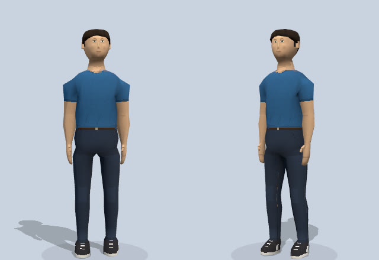 | **Crowd 01**<br>`multidao_01`<br>Man in the crowd: blue T-shirt, jeans, sneakers, short dark hair.<br>[poses](previas/multidao_01_poses.jpg) | 1,166 | 260.8 KB |
| 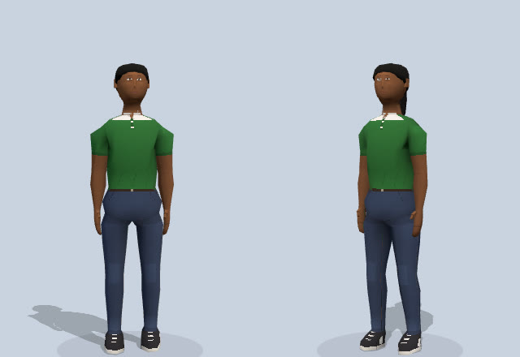 | **Crowd 02**<br>`multidao_02`<br>Woman in the crowd: green polo shirt with a white collar, jeans, sneakers, dark ponytail.<br>[poses](previas/multidao_02_poses.jpg) | 1,226 | 249.9 KB |
| 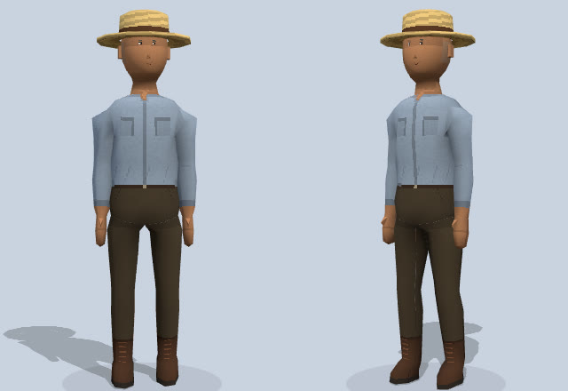 | **Crowd 03**<br>`multidao_03`<br>Older man in the crowd: light blue button-up shirt, brown dress pants, boots, straw hat.<br>[poses](previas/multidao_03_poses.jpg) | 1,190 | 261.6 KB |
| 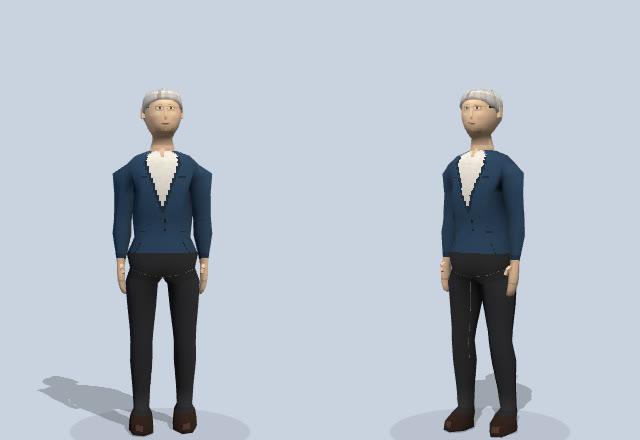 | **Crowd 04**<br>`multidao_04`<br>Older woman in the crowd: navy blue blazer over a white shirt, navy blue dress pants, shoes, gray bun, glasses.<br>[poses](previas/multidao_04_poses.jpg) | 1,202 | 264.5 KB |
| 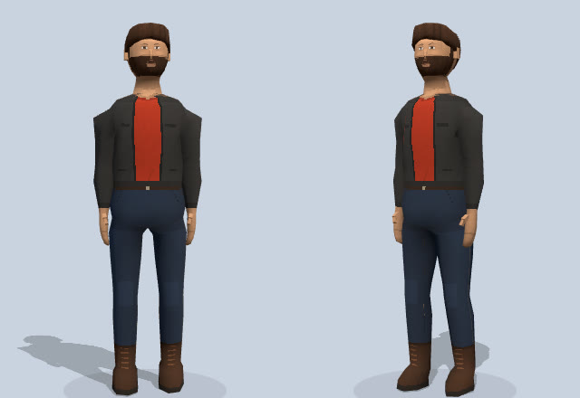 | **Crowd 05**<br>`multidao_05`<br>Man in the crowd: open gray jacket over a red T-shirt, jeans, boots, chestnut quiff, beard.<br>[poses](previas/multidao_05_poses.jpg) | 1,166 | 254.1 KB |
| 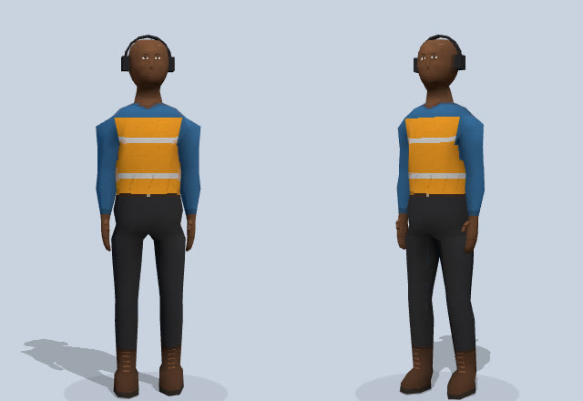 | **Crowd 06**<br>`multidao_06`<br>Man in the crowd: orange reflective vest over a blue shirt, navy blue dress pants, boots, bald, headset.<br>[poses](previas/multidao_06_poses.jpg) | 1,178 | 254.4 KB |
| 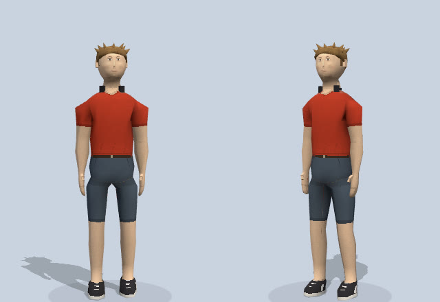 | **Crowd 07**<br>`multidao_07`<br>Man in the crowd: red T-shirt, navy blue shorts, sneakers, spiky chestnut hair, headphones around his neck.<br>[poses](previas/multidao_07_poses.jpg) | 1,306 | 282.9 KB |
| 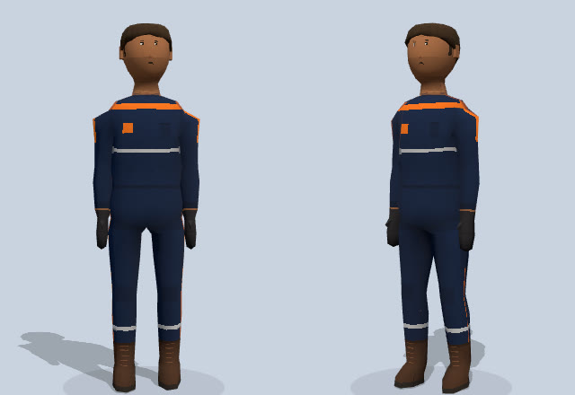 | **Crowd 08**<br>`multidao_08`<br>Man in the crowd: navy blue team overalls with orange stripes, boots, gloves, short chestnut hair, mustache.<br>[poses](previas/multidao_08_poses.jpg) | 1,166 | 238.8 KB |
| 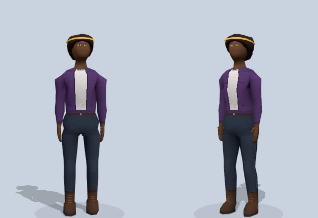 | **Crowd 09**<br>`multidao_09`<br>Woman in the crowd: open purple jacket over a white T-shirt, jeans, boots, dark curly hair, headband.<br>[poses](previas/multidao_09_poses.jpg) | 1,226 | 257.9 KB |
| 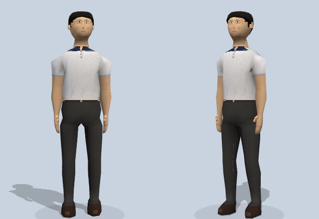 | **Crowd 10**<br>`multidao_10`<br>Man in the crowd: white polo shirt with a navy blue collar, gray dress pants, shoes, short dark hair, glasses.<br>[poses](previas/multidao_10_poses.jpg) | 1,166 | 249.0 KB |
| 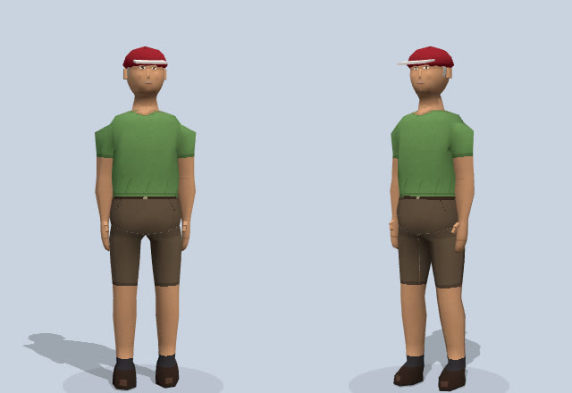 | **Crowd 11**<br>`multidao_11`<br>Older man in the crowd: green T-shirt, brown shorts, shoes, mustache, cap.<br>[poses](previas/multidao_11_poses.jpg) | 1,154 | 263.5 KB |
| 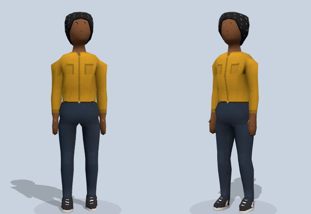 | **Crowd 12**<br>`multidao_12`<br>Older woman in the crowd: orange button-up shirt, jeans, sneakers, headscarf.<br>[poses](previas/multidao_12_poses.jpg) | 1,166 | 248.8 KB |
| 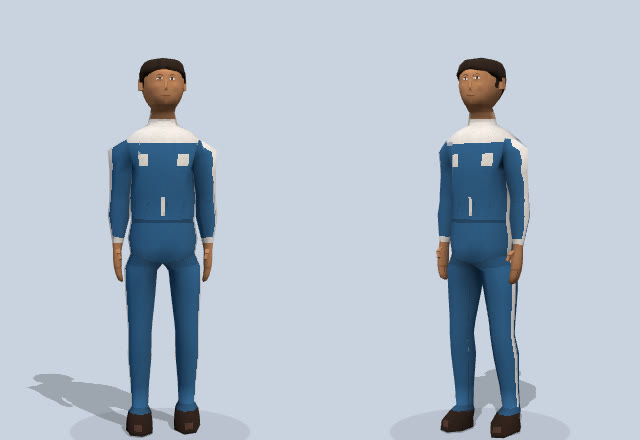 | **Crowd 13**<br>`multidao_13`<br>Man in the crowd: blue racing suit with white stripes, shoes, short dark hair.<br>[poses](previas/multidao_13_poses.jpg) | 1,166 | 258.5 KB |
| 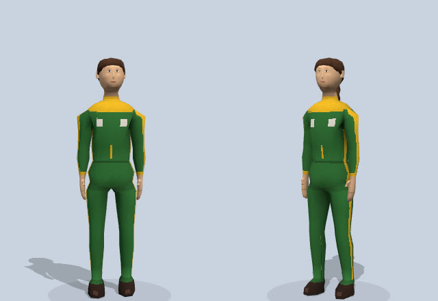 | **Crowd 14**<br>`multidao_14`<br>Woman in the crowd: green racing suit with yellow stripes, shoes, chestnut braid.<br>[poses](previas/multidao_14_poses.jpg) | 1,322 | 271.1 KB |
| 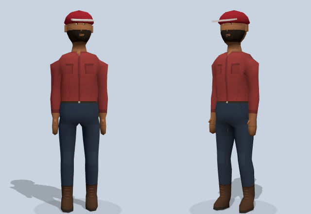 | **Crowd 15**<br>`multidao_15`<br>Man in the crowd: red button-up shirt, jeans, boots, beard, cap.<br>[poses](previas/multidao_15_poses.jpg) | 1,154 | 253.1 KB |
| 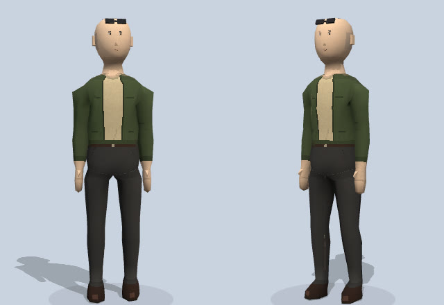 | **Crowd 16**<br>`multidao_16`<br>Man in the crowd: open green jacket over a beige T-shirt, gray dress pants, shoes, bald, glasses on his forehead.<br>[poses](previas/multidao_16_poses.jpg) | 1,190 | 263.8 KB |
| 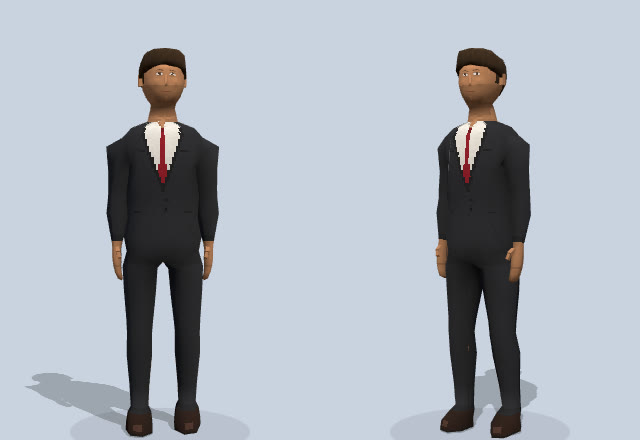 | **Crowd 17**<br>`multidao_17`<br>Man in the crowd: navy blue blazer with a red tie, navy blue dress pants, shoes, chestnut quiff.<br>[poses](previas/multidao_17_poses.jpg) | 1,166 | 239.4 KB |
| 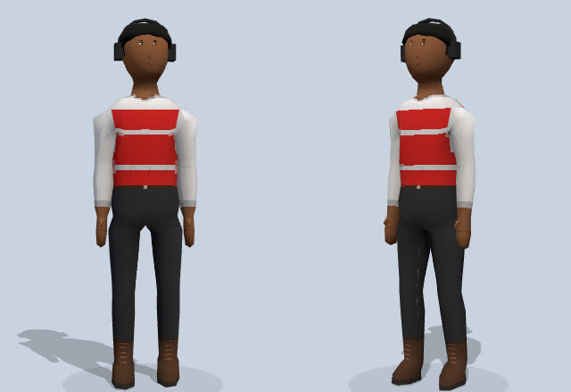 | **Crowd 18**<br>`multidao_18`<br>Man in the crowd: red reflective vest over a white shirt, navy blue dress pants, boots, short dark hair, headset.<br>[poses](previas/multidao_18_poses.jpg) | 1,286 | 260.2 KB |
|  | **Crowd 19**<br>`multidao_19`<br>Woman in the crowd: pink T-shirt, blue shorts, sneakers, chestnut bun.<br>[poses](previas/multidao_19_poses.jpg) | 1,202 | 272.0 KB |
|  | **Crowd 20**<br>`multidao_20`<br>Man in the crowd: open green jacket over a beige T-shirt, jeans, sneakers, dark quiff.<br>[poses](previas/multidao_20_poses.jpg) | 1,166 | 243.4 KB |
|  | **Crowd 21**<br>`multidao_21`<br>Older man in the crowd: blue polo shirt, brown dress pants, shoes, bald, glasses.<br>[poses](previas/multidao_21_poses.jpg) | 1,058 | 256.0 KB |
|  | **Crowd 22**<br>`multidao_22`<br>Woman in the crowd: orange team overalls with navy blue stripes, boots, gloves, dark ponytail.<br>[poses](previas/multidao_22_poses.jpg) | 1,226 | 263.0 KB |
|  | **Crowd 23**<br>`multidao_23`<br>Man in the crowd: light blue button-up shirt, brown shorts, boots, short chestnut hair, rag on his shoulder.<br>[poses](previas/multidao_23_poses.jpg) | 1,214 | 267.6 KB |
|  | **Crowd 24**<br>`multidao_24`<br>Man in the crowd: white T-shirt, jeans, sneakers, dark curly hair, beard.<br>[poses](previas/multidao_24_poses.jpg) | 1,166 | 230.6 KB |

## Skeleton

The same names and the same hierarchy in every file, so animations can be swapped between characters (and animations from other humanoid skeletons can be reused by mapping bone to bone):

```
Quadril (raiz)
├── Coluna → Peito
│            ├── Pescoco → Cabeca
│            ├── Ombro_E → Braco_E → Antebraco_E → Mao_E
│            └── Ombro_D → Braco_D → Antebraco_D → Mao_D
├── Coxa_E → Canela_E → Pe_E
└── Coxa_D → Canela_D → Pe_D
```

`_E` = the character's left (+X), `_D` = right. Quadril = hips, Coluna = spine, Peito = chest, Pescoco = neck, Cabeca = head, Ombro = clavicle, Braco = upper arm, Antebraco = forearm, Mao = hand, Coxa = thigh, Canela = shin, Pe = foot.

## Folders

- `modelos/<id>.glb`: the finished character, with mesh, skin, skeleton, texture and clips.
- `texturas/<id>.png`: the 256×512 px texture (the same one embedded in the `.glb`).
- `previas/<id>.jpg`: front and three-quarter view; `previas/<id>_poses.jpg`: one frame of each clip.
- `catalogo.json`: all the characters with name, type, description, triangles, size, height and file paths, plus the skeleton and the clips.
- `docs/`: mosaic and pose sheet.

## How to use the models

- Meters, Y axis up, the character faces +Z, the origin sits on the ground between the feet.
- Use "nearest" filtering on the texture (it already comes that way in the file) and a simple diffuse material: the main light and shadow are already painted in.
- The animations are on the skeleton: play any clip by name, in a loop. For crowds, play the same clip with different start times.

Example in JavaScript, with the glTF loader and the animation mixer of your 3D web library:

```js
const glb = await carregadorGltf.loadAsync("modelos/zelia.glb");
cena.add(glb.scene);
const misturador = new MisturadorDeAnimacao(glb.scene);
const andar = glb.animations.find((c) => c.name === "andar");
misturador.clipAction(andar).play();
// a cada quadro: misturador.update(dt)
```

## Frequently asked questions

**What format are the characters in?**
Binary glTF 2.0 (`.glb`), one file per character, with mesh, skin, skeleton, material, texture and animations embedded. The texture is also available as a loose PNG in the `texturas/` folder.

**Can I import them into any game engine or 3D program?**
Yes, into any engine, web library or 3D editor that reads glTF 2.0 with skinning. There are no proprietary extensions.

**Can I swap animations between characters?**
Yes. All of them have the same skeleton (same names, hierarchy and rest pose), so any clip from one character plays on any other.

**Can I use them in a commercial game?**
Yes. The characters are in the public domain (CC0 1.0): use, modify and redistribute them without asking for permission or giving credit. Credit is welcome (see [`CITATION.cff`](CITATION.cff)).

**Do the characters imitate real people, brands or games?**
No. Names, faces, clothes and colors are made up; the overalls and clothes have no logo, brand or real company text.

**How were they made?**
By script: the body is a mesh of stitched rings (12-sided torso and head, 6-sided arms, 7-sided legs), with a UV layout designed for the face and skin weights per ring; the texture is painted by code region by region (face, clothes, pants, footwear and hair) and the animations are calculated frame by frame on the skeleton. Each file was opened again and had every clip played to check that no joint tears.

## License

[CC0 1.0 Universal](LICENSE): public domain.

## How to cite

The citation metadata is in [`CITATION.cff`](CITATION.cff).
