# Scitizia: 55 personagens low poly com esqueleto e animações, em glTF/GLB com visual retrô de 32 bits

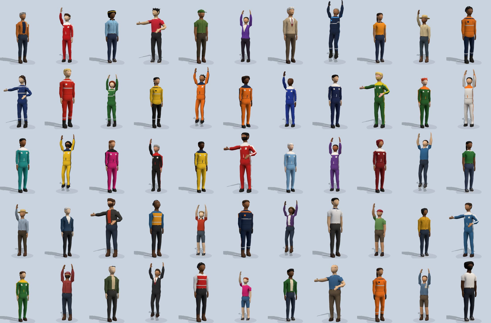

**Scitizia: pessoas** é uma coleção gratuita de 55 personagens em baixo polígono (low poly), com o visual retrô dos jogos de 32 bits, prontos para jogos em tempo real: 31 personagens com nome (história, copilotos e pilotos) e 24 variações de multidão. Cada personagem é um arquivo glTF 2.0 binário (`.glb`) de 231 a 368 KB com **uma malha contínua com pele** de 1.058 a 1.750 triângulos, o **mesmo esqueleto humanoide de 19 ossos** em todos (pose A no repouso, até 4 ossos por vértice), uma textura de 256×512 px pintada por código, com rosto, roupa e cabelo em pixels, luz e sombra assadas e filtro "nearest", e **10 animações em loop** no esqueleto: parado, andar, correr, empurrar, comemorar, acenar, pular, sentar, torcer, apontar. Os personagens foram feitos para o jogo **Scitizia Rally Championship**; nomes, rostos e roupas são inventados, sem marca, logotipo ou pessoa real.

**English summary:** Scitizia people is a free pack of 55 rigged low-poly characters with a retro 32-bit look: 31 named characters from a rally game (mentor, rival, radio host, team bosses, co-drivers and 16 driver avatars) and 24 crowd variations. Every character is a binary glTF 2.0 (`.glb`) file with one continuous skinned mesh (1058 to 1750 triangles), the same 19-bone humanoid skeleton in an A-pose rest (hips, spine, chest, neck, head, clavicle/upper arm/forearm/hand and thigh/shin/foot on each side, max 4 weights per vertex), a procedurally painted 256×512 nearest-filtered texture with baked lighting, and 10 looping animations on the skeleton (idle, walk, run, push, cheer, wave, jump, sit, crowd cheer, point). Units are meters, Y is up and characters face +Z. A machine-readable list is in [`catalogo.json`](catalogo.json). Public domain (CC0 1.0).

## Resumo

| | |
|---|---|
| Personagens | 55: personagens da história 10, copilotos 5, pilotos 16, multidão 24 |
| Formato | glTF 2.0 binário (`.glb`), textura também em PNG |
| Malha | uma malha contínua com pele (sem peças soltas nas juntas), 1.058 a 1.750 triângulos (média 1.434); cabelo, nariz, orelhas e acessórios presos à cabeça na mesma malha |
| Esqueleto | 19 ossos, o mesmo em todos, pose A no repouso, até 4 ossos por vértice |
| Animações | 10 clipes em loop no esqueleto, amostrados a 15 quadros por segundo |
| Textura | 256×512 px por personagem, filtro "nearest" (pixels nítidos), luz e oclusão assadas; a metade de baixo tem o rosto em alta e quadros de olhos e boca para expressões (piscar, falar, sorrir) |
| Expressões | elenco (31): 4 morph targets na malha (`boca` abre a mandíbula, `sorriso`, `sobrancelha` sobe, `franze`), nomes em `extras.targetNames`; a multidão não tem |
| Tamanho | 231 a 368 KB por arquivo |
| Escala e eixos | metros, Y para cima, olhando para +Z, origem no chão entre os pés, 1,57 a 1,93 m de altura (com cabelo e chapéu) |
| Catálogo legível por máquina | [`catalogo.json`](catalogo.json) |
| Licença | domínio público, [CC0 1.0](LICENSE) |

## Animações

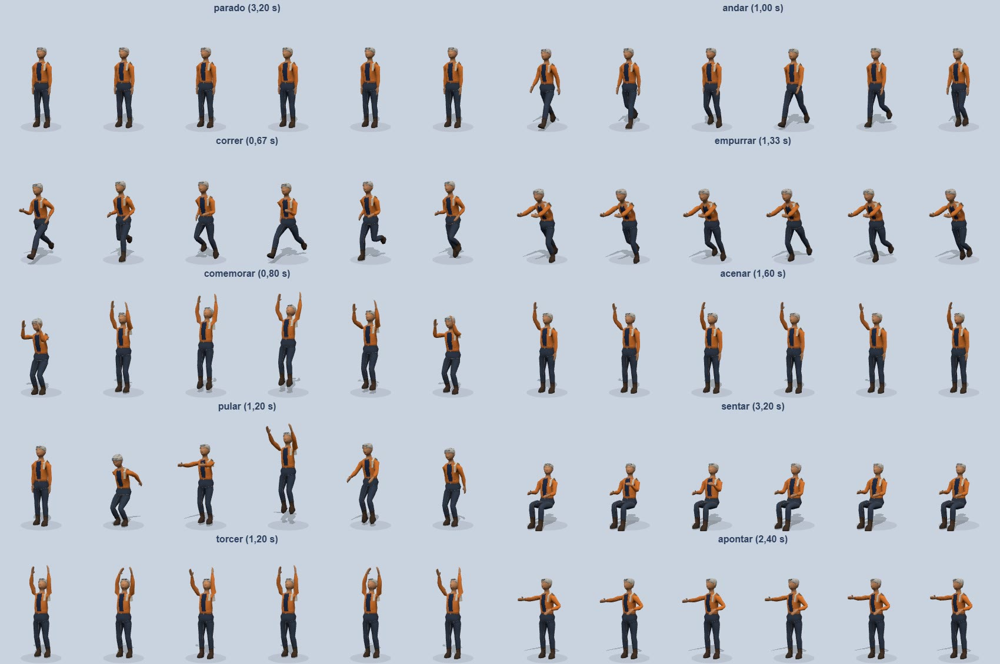

| Clipe | Duração | O que faz |
|---|---|---|
| `parado` | 3,20 s | parado respirando, troca o peso de perna e olha em volta |
| `andar` | 1,00 s | ciclo de passos no lugar (1,37 m por ciclo: 1,37 m/s) |
| `correr` | 0,67 s | corrida no lugar (2,2 m por ciclo: 3,3 m/s) |
| `empurrar` | 1,33 s | empurrando um carro com as duas mãos, dando passos curtos (0,75 m/s) |
| `comemorar` | 0,80 s | pulando com os braços para cima |
| `acenar` | 1,60 s | acenando com a mão direita |
| `pular` | 1,20 s | agacha, pula e cai no lugar |
| `sentar` | 3,20 s | sentado (assento a ~0,45 m), gesticulando e olhando em volta |
| `torcer` | 1,20 s | torcendo com os braços para cima, quicando |
| `apontar` | 2,40 s | apontando para a frente com a mão direita, a outra na cintura |

Todos os clipes animam a rotação de todos os ossos (e a posição do `Quadril`), então trocar de um para outro nunca deixa sobra de pose. Andar, correr e empurrar são feitos no lugar: mova o personagem pelo jogo na velocidade indicada.

## Personagens da história

A mentora, o rival, a locutora da rádio, os chefes de equipe, o dono da equipe rival, o chefe dos mecânicos e o sitiante da porteira. 10 personagens.

| Prévia (frente e 3/4) | Personagem | Triângulos | Tamanho |
|---|---|---|---|
| 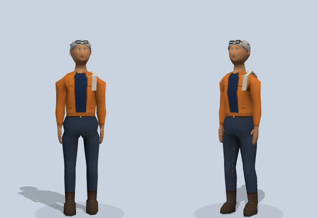 | **Zélia Brandão**<br>`zelia`<br>Mentora, chefe da Oficina Brandão: jaqueta aberta laranja sobre camiseta azul-marinho, calça jeans, botas, cabelo curto grisalho, óculos na testa, pano no ombro.<br>[poses](previas/zelia_poses.jpg) | 1.750 | 367,6 KB |
| 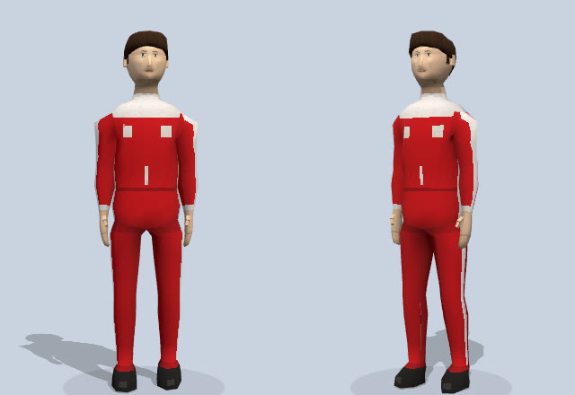 | **Breno Cardim**<br>`breno`<br>Piloto rival: macacão de piloto vermelho com faixas brancas, sapatos, topete castanho.<br>[poses](previas/breno_poses.jpg) | 1.570 | 331,2 KB |
| 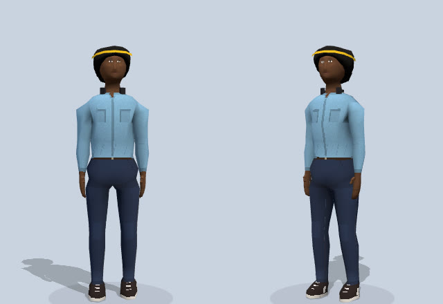 | **Lu Arantes**<br>`lu`<br>Locutora da rádio: camisa de botões azul-claro, calça jeans, tênis, cabelo cacheado escuro, faixa no cabelo, fone no pescoço.<br>[poses](previas/lu_poses.jpg) | 1.726 | 343,8 KB |
| 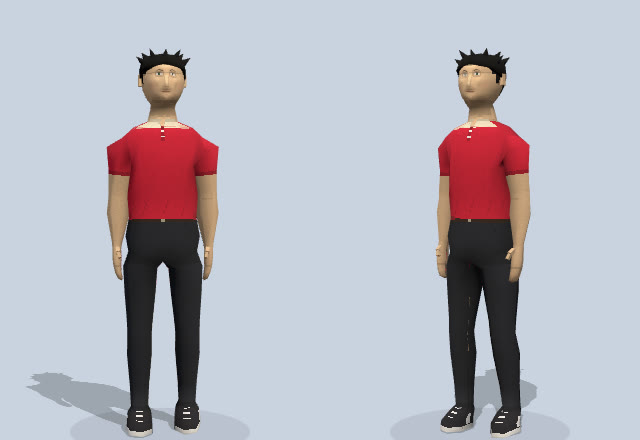 | **Rafa Okumura**<br>`rafa`<br>Chefe de um programa de jovens pilotos: camisa polo vermelha de gola bege, calça social azul-marinho, tênis, cabelo espetado escuro, óculos.<br>[poses](previas/rafa_poses.jpg) | 1.614 | 330,6 KB |
| 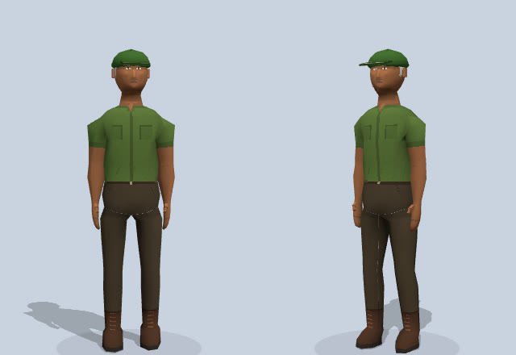 | **Tião Mourão**<br>`tiao`<br>Fundador de um coletivo de pilotos independentes: camisa de botões verde de mangas curtas, calça social marrom, botas, bigode, boné.<br>[poses](previas/tiao_poses.jpg) | 1.558 | 326,2 KB |
| 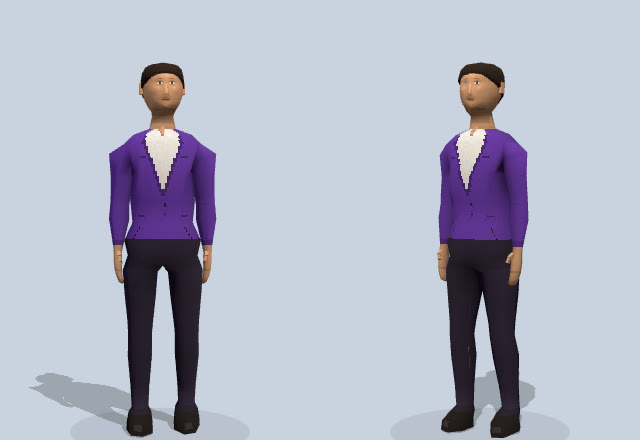 | **Marta Quintela**<br>`marta`<br>Diretora de equipe: paletó roxo sobre camisa branca, calça social roxa, sapatos, coque escuro.<br>[poses](previas/marta_poses.jpg) | 1.606 | 332,4 KB |
| 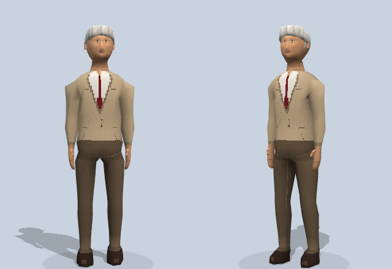 | **Augusto Cardim**<br>`cardim`<br>Dono da equipe rival: paletó bege com gravata vinho, calça social marrom, sapatos, topete branco, bigode.<br>[poses](previas/cardim_poses.jpg) | 1.570 | 332,8 KB |
| 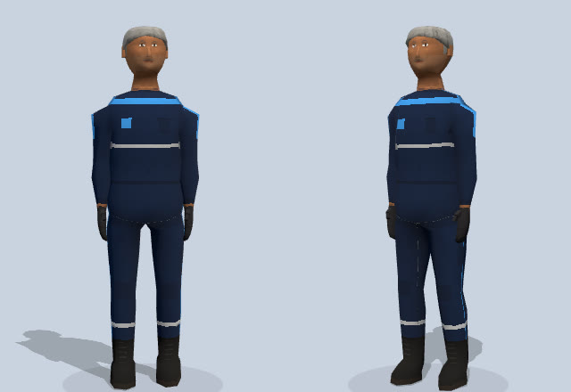 | **Dito**<br>`dito`<br>Chefe dos mecânicos: macacão de equipe azul-marinho com faixas azuis, botas, luvas, cabelo curto grisalho, bigode.<br>[poses](previas/dito_poses.jpg) | 1.570 | 309,7 KB |
| 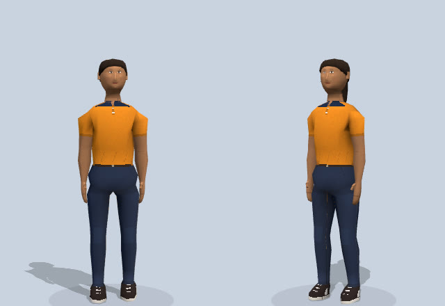 | **Rosa**<br>`rosa`<br>Chefe de equipe: camisa polo laranja de gola azul-marinho, calça jeans, tênis, rabo de cavalo escuro.<br>[poses](previas/rosa_poses.jpg) | 1.630 | 333,8 KB |
| 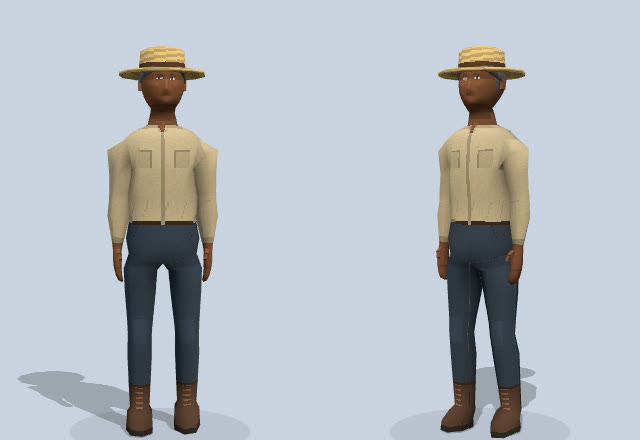 | **Seu Bento**<br>`bento`<br>Sitiante da porteira: camisa de botões bege, calça jeans, botas, chapéu de palha.<br>[poses](previas/bento_poses.jpg) | 1.702 | 338,0 KB |

## Copilotos

Os cinco copilotos, de macacão de equipe e fone de cabeça. 5 personagens.

| Prévia (frente e 3/4) | Personagem | Triângulos | Tamanho |
|---|---|---|---|
| 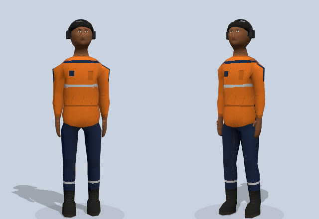 | **Caetano Brito**<br>`caetano`<br>Copiloto: macacão de equipe laranja com faixas azul-marinho, botas, cabelo curto escuro, fone de cabeça.<br>[poses](previas/caetano_poses.jpg) | 1.690 | 340,4 KB |
| 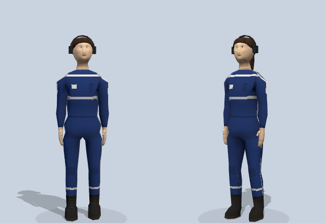 | **Inês Valadares**<br>`ines`<br>Copiloto: macacão de equipe azul-marinho com faixas brancas, botas, rabo de cavalo castanho, fone de cabeça.<br>[poses](previas/ines_poses.jpg) | 1.750 | 360,3 KB |
| 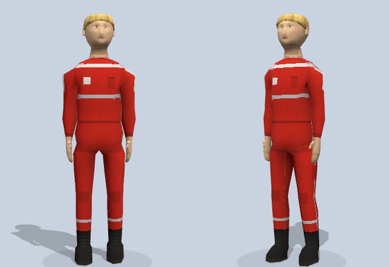 | **Cody Harlan**<br>`cody`<br>Copiloto: macacão de equipe vermelho com faixas brancas, botas, cabelo curto loiro.<br>[poses](previas/cody_poses.jpg) | 1.570 | 338,4 KB |
| 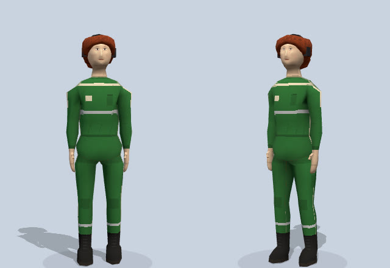 | **Fiona Ashworth**<br>`fiona`<br>Copiloto: macacão de equipe verde com faixas bege, botas, cabelo cacheado castanho, fone de cabeça.<br>[poses](previas/fiona_poses.jpg) | 1.726 | 363,3 KB |
| 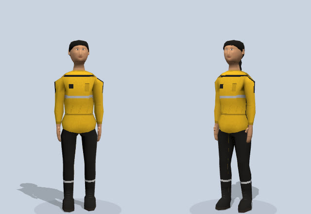 | **Lucía Moraleda**<br>`lucia`<br>Copiloto: macacão de equipe amarelo com faixas pretas, botas, trança escura.<br>[poses](previas/lucia_poses.jpg) | 1.726 | 330,4 KB |

## Pilotos

Os 16 avatares de piloto do jogador, de macacão de piloto, com rostos, idades, peles e penteados variados. 16 personagens.

| Prévia (frente e 3/4) | Personagem | Triângulos | Tamanho |
|---|---|---|---|
| 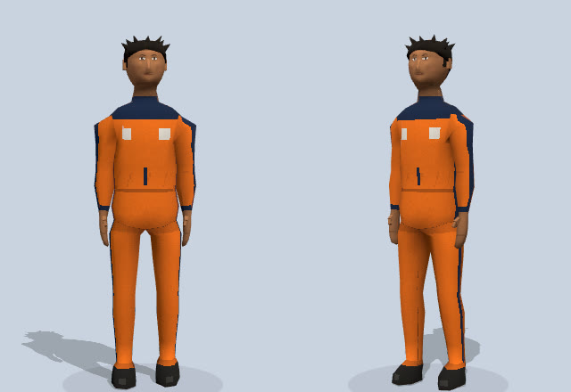 | **Piloto H01**<br>`piloto_h01`<br>Avatar de piloto (homem, 22 anos): macacão de piloto laranja com faixas azul-marinho, sapatos, cabelo espetado escuro.<br>[poses](previas/piloto_h01_poses.jpg) | 1.614 | 334,2 KB |
| 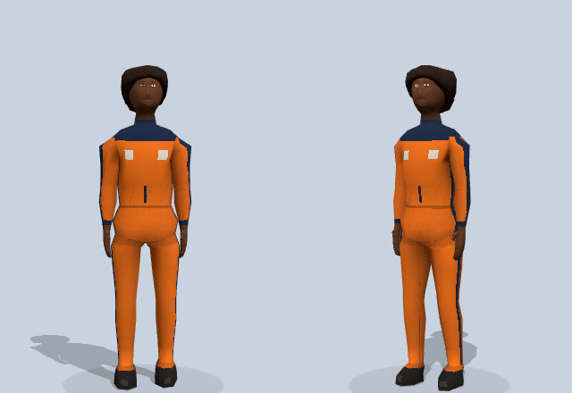 | **Piloto M01**<br>`piloto_m01`<br>Avatar de piloto (mulher, 25 anos): macacão de piloto laranja com faixas azul-marinho, sapatos, cabelo cacheado escuro.<br>[poses](previas/piloto_m01_poses.jpg) | 1.606 | 326,9 KB |
| 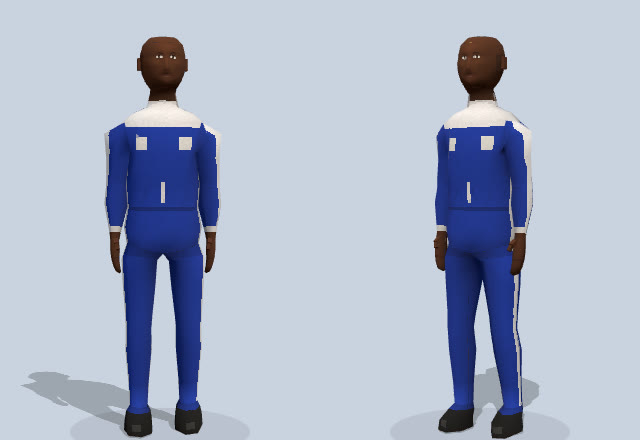 | **Piloto H02**<br>`piloto_h02`<br>Avatar de piloto (homem, 30 anos): macacão de piloto azul com faixas brancas, sapatos, careca.<br>[poses](previas/piloto_h02_poses.jpg) | 1.462 | 307,2 KB |
| 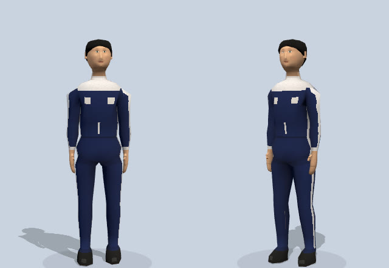 | **Piloto M02**<br>`piloto_m02`<br>Avatar de piloto (mulher, 34 anos): macacão de piloto azul-marinho com faixas brancas, sapatos, cabelo curto escuro.<br>[poses](previas/piloto_m02_poses.jpg) | 1.570 | 318,9 KB |
| 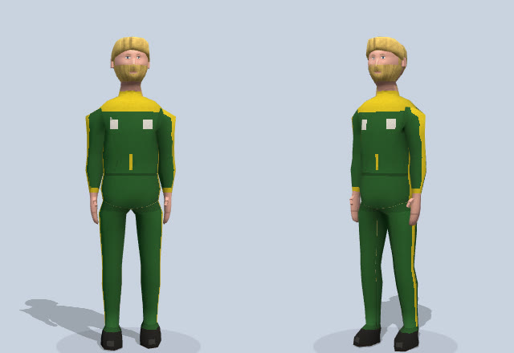 | **Piloto H03**<br>`piloto_h03`<br>Avatar de piloto (homem, 45 anos): macacão de piloto verde com faixas amarelas, sapatos, topete loiro, barba.<br>[poses](previas/piloto_h03_poses.jpg) | 1.570 | 336,2 KB |
| 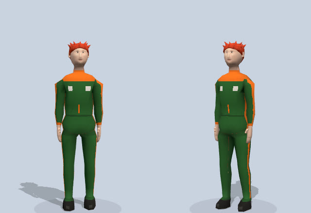 | **Piloto M03**<br>`piloto_m03`<br>Avatar de piloto (mulher, 48 anos): macacão de piloto verde com faixas laranja, sapatos, cabelo espetado ruivo.<br>[poses](previas/piloto_m03_poses.jpg) | 1.614 | 346,2 KB |
| 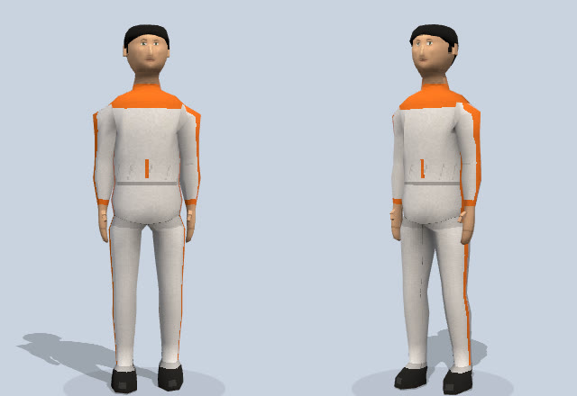 | **Piloto H04**<br>`piloto_h04`<br>Avatar de piloto (homem, 27 anos): macacão de piloto branco com faixas laranja, sapatos, cabelo curto escuro.<br>[poses](previas/piloto_h04_poses.jpg) | 1.570 | 319,6 KB |
| 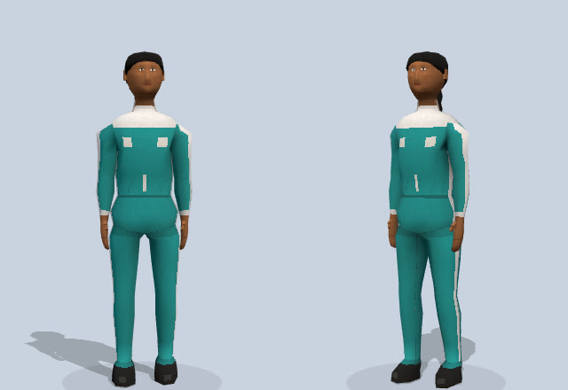 | **Piloto M04**<br>`piloto_m04`<br>Avatar de piloto (mulher, 29 anos): macacão de piloto azul com faixas brancas, sapatos, trança escura.<br>[poses](previas/piloto_m04_poses.jpg) | 1.726 | 326,8 KB |
| 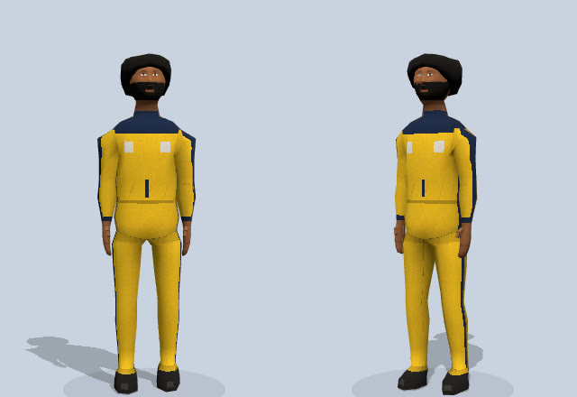 | **Piloto H05**<br>`piloto_h05`<br>Avatar de piloto (homem, 38 anos): macacão de piloto amarelo com faixas azul-marinho, sapatos, cabelo cacheado escuro, barba.<br>[poses](previas/piloto_h05_poses.jpg) | 1.570 | 312,4 KB |
| 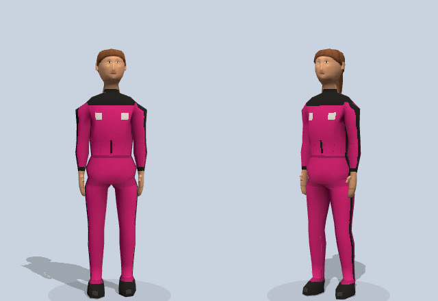 | **Piloto M05**<br>`piloto_m05`<br>Avatar de piloto (mulher, 22 anos): macacão de piloto rosa com faixas pretas, sapatos, rabo de cavalo castanho.<br>[poses](previas/piloto_m05_poses.jpg) | 1.630 | 338,0 KB |
| 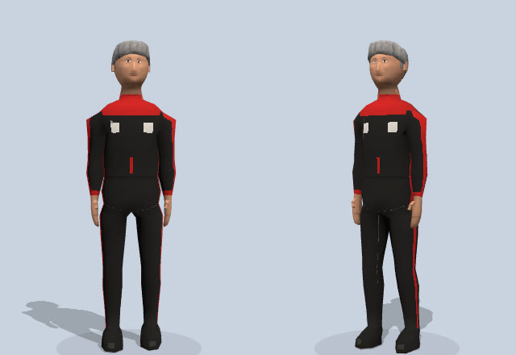 | **Piloto H06**<br>`piloto_h06`<br>Avatar de piloto (homem, 56 anos): macacão de piloto preto com faixas vermelhas, sapatos, topete grisalho.<br>[poses](previas/piloto_h06_poses.jpg) | 1.570 | 316,3 KB |
| 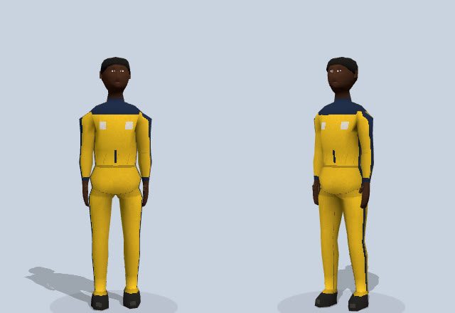 | **Piloto M06**<br>`piloto_m06`<br>Avatar de piloto (mulher, 41 anos): macacão de piloto amarelo com faixas azul-marinho, sapatos, coque escuro.<br>[poses](previas/piloto_m06_poses.jpg) | 1.606 | 314,9 KB |
| 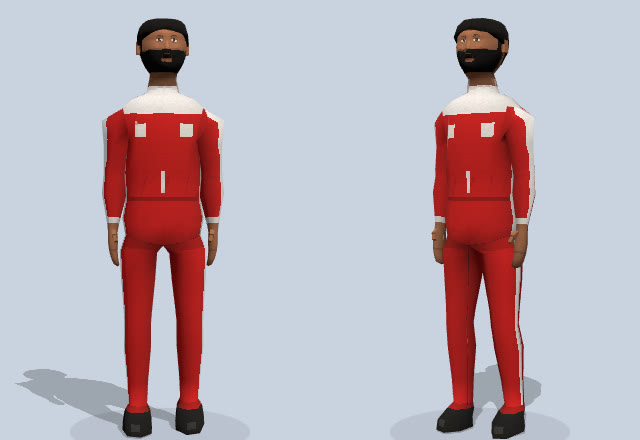 | **Piloto H07**<br>`piloto_h07`<br>Avatar de piloto (homem, 33 anos): macacão de piloto vermelho com faixas brancas, sapatos, cabelo curto escuro, barba.<br>[poses](previas/piloto_h07_poses.jpg) | 1.570 | 308,4 KB |
| 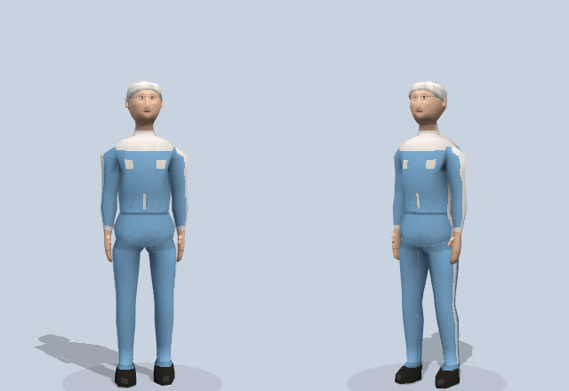 | **Piloto M07**<br>`piloto_m07`<br>Avatar de piloto (mulher, 58 anos): macacão de piloto azul-claro com faixas brancas, sapatos, coque branco, óculos.<br>[poses](previas/piloto_m07_poses.jpg) | 1.606 | 336,1 KB |
| 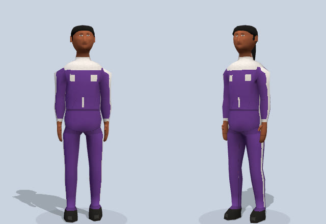 | **Piloto H08**<br>`piloto_h08`<br>Avatar de piloto (homem, 24 anos): macacão de piloto roxo com faixas brancas, sapatos, rabo de cavalo escuro.<br>[poses](previas/piloto_h08_poses.jpg) | 1.630 | 323,6 KB |
| 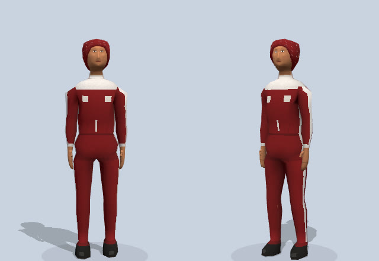 | **Piloto M08**<br>`piloto_m08`<br>Avatar de piloto (mulher, 31 anos): macacão de piloto vermelho com faixas brancas, sapatos, lenço na cabeça.<br>[poses](previas/piloto_m08_poses.jpg) | 1.570 | 322,9 KB |

## Multidão

Variações para público, fiscais, mecânicos e figurantes: combinações de rosto, roupa, calça, calçado, penteado e acessórios. 24 personagens.

| Prévia (frente e 3/4) | Personagem | Triângulos | Tamanho |
|---|---|---|---|
| 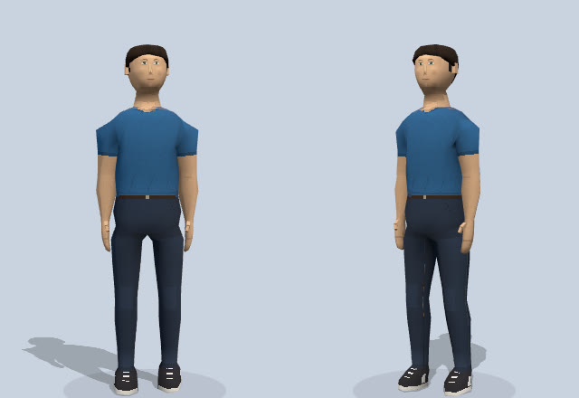 | **Multidão 01**<br>`multidao_01`<br>Homem do público: camiseta azul, calça jeans, tênis, cabelo curto escuro.<br>[poses](previas/multidao_01_poses.jpg) | 1.166 | 260,8 KB |
| 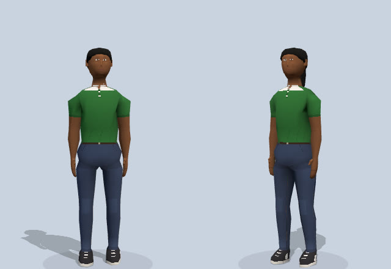 | **Multidão 02**<br>`multidao_02`<br>Mulher do público: camisa polo verde de gola branca, calça jeans, tênis, rabo de cavalo escuro.<br>[poses](previas/multidao_02_poses.jpg) | 1.226 | 249,9 KB |
| 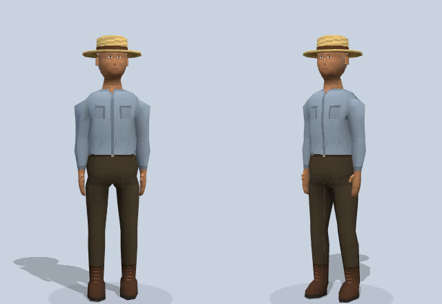 | **Multidão 03**<br>`multidao_03`<br>Homem mais velho do público: camisa de botões azul-claro, calça social marrom, botas, chapéu de palha.<br>[poses](previas/multidao_03_poses.jpg) | 1.190 | 261,6 KB |
| 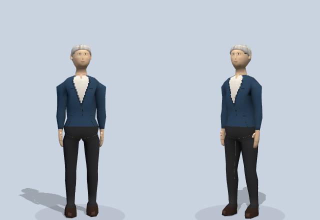 | **Multidão 04**<br>`multidao_04`<br>Mulher mais velha do público: paletó azul-marinho sobre camisa branca, calça social azul-marinho, sapatos, coque grisalho, óculos.<br>[poses](previas/multidao_04_poses.jpg) | 1.202 | 264,5 KB |
| 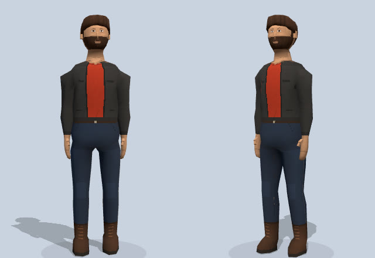 | **Multidão 05**<br>`multidao_05`<br>Homem do público: jaqueta aberta cinza sobre camiseta vermelha, calça jeans, botas, topete castanho, barba.<br>[poses](previas/multidao_05_poses.jpg) | 1.166 | 254,1 KB |
| 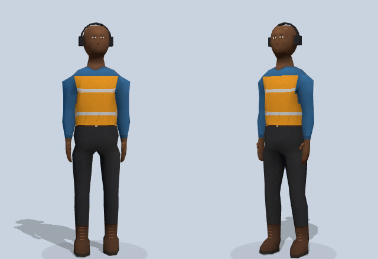 | **Multidão 06**<br>`multidao_06`<br>Homem do público: colete refletivo laranja sobre camisa azul, calça social azul-marinho, botas, careca, fone de cabeça.<br>[poses](previas/multidao_06_poses.jpg) | 1.178 | 254,4 KB |
| 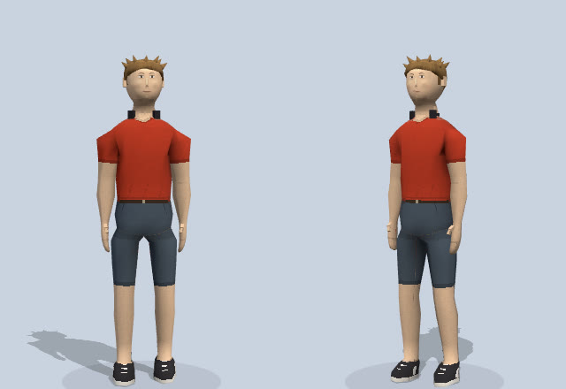 | **Multidão 07**<br>`multidao_07`<br>Homem do público: camiseta vermelha, bermuda azul-marinho, tênis, cabelo espetado castanho, fone no pescoço.<br>[poses](previas/multidao_07_poses.jpg) | 1.306 | 282,9 KB |
| 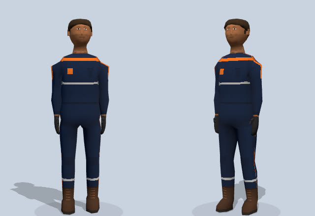 | **Multidão 08**<br>`multidao_08`<br>Homem do público: macacão de equipe azul-marinho com faixas laranja, botas, luvas, cabelo curto castanho, bigode.<br>[poses](previas/multidao_08_poses.jpg) | 1.166 | 238,8 KB |
| 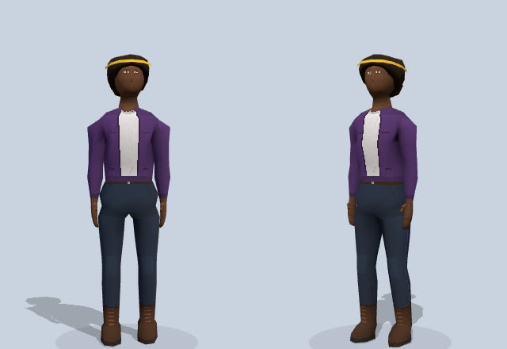 | **Multidão 09**<br>`multidao_09`<br>Mulher do público: jaqueta aberta roxa sobre camiseta branca, calça jeans, botas, cabelo cacheado escuro, faixa no cabelo.<br>[poses](previas/multidao_09_poses.jpg) | 1.226 | 257,9 KB |
| 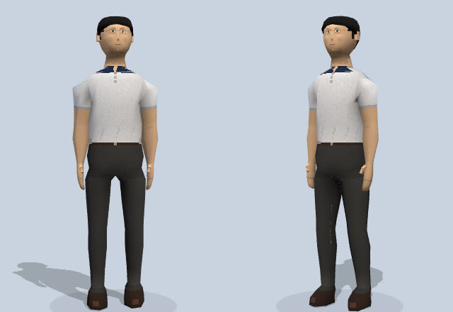 | **Multidão 10**<br>`multidao_10`<br>Homem do público: camisa polo branca de gola azul-marinho, calça social cinza, sapatos, cabelo curto escuro, óculos.<br>[poses](previas/multidao_10_poses.jpg) | 1.166 | 249,0 KB |
| 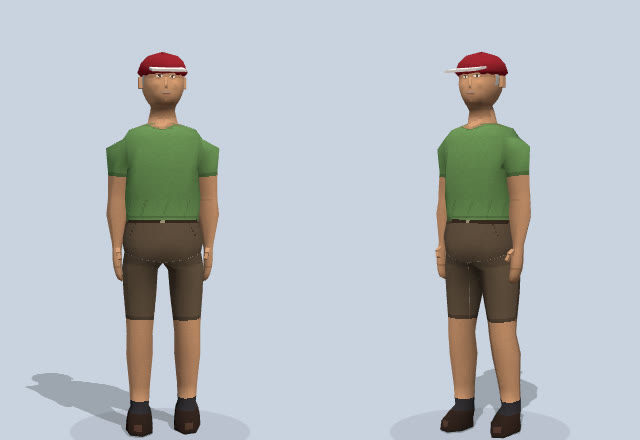 | **Multidão 11**<br>`multidao_11`<br>Homem mais velho do público: camiseta verde, bermuda marrom, sapatos, bigode, boné.<br>[poses](previas/multidao_11_poses.jpg) | 1.154 | 263,5 KB |
| 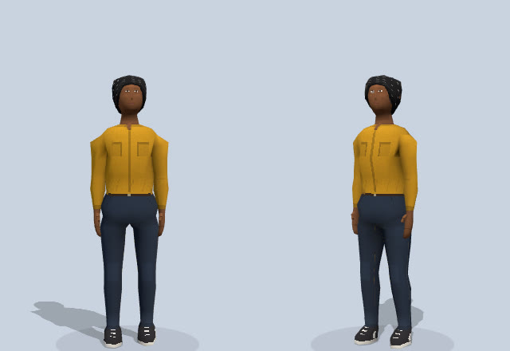 | **Multidão 12**<br>`multidao_12`<br>Mulher mais velha do público: camisa de botões laranja, calça jeans, tênis, lenço na cabeça.<br>[poses](previas/multidao_12_poses.jpg) | 1.166 | 248,8 KB |
| 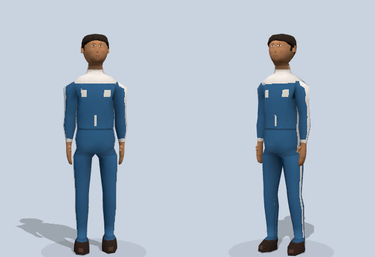 | **Multidão 13**<br>`multidao_13`<br>Homem do público: macacão de piloto azul com faixas brancas, sapatos, cabelo curto escuro.<br>[poses](previas/multidao_13_poses.jpg) | 1.166 | 258,5 KB |
| 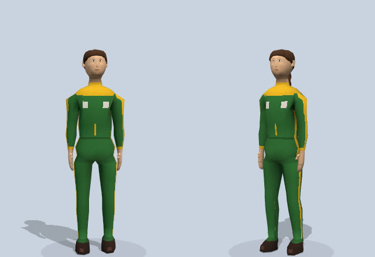 | **Multidão 14**<br>`multidao_14`<br>Mulher do público: macacão de piloto verde com faixas amarelas, sapatos, trança castanha.<br>[poses](previas/multidao_14_poses.jpg) | 1.322 | 271,1 KB |
| 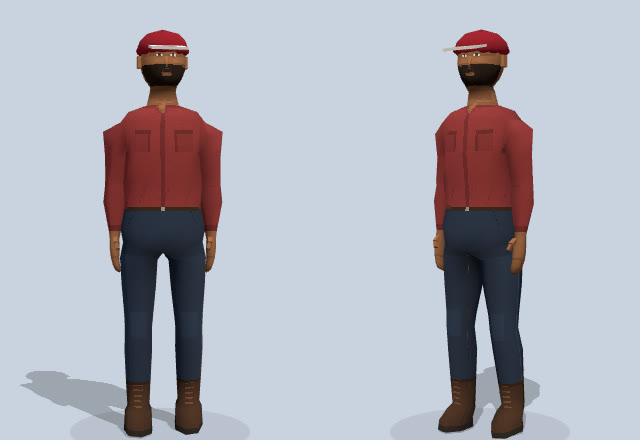 | **Multidão 15**<br>`multidao_15`<br>Homem do público: camisa de botões vermelha, calça jeans, botas, barba, boné.<br>[poses](previas/multidao_15_poses.jpg) | 1.154 | 253,1 KB |
| 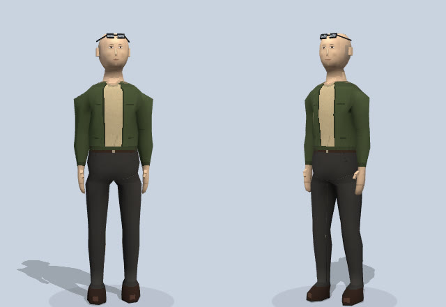 | **Multidão 16**<br>`multidao_16`<br>Homem do público: jaqueta aberta verde sobre camiseta bege, calça social cinza, sapatos, careca, óculos na testa.<br>[poses](previas/multidao_16_poses.jpg) | 1.190 | 263,8 KB |
| 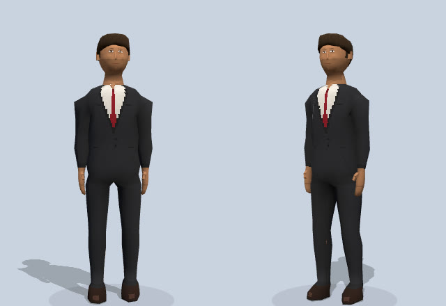 | **Multidão 17**<br>`multidao_17`<br>Homem do público: paletó azul-marinho com gravata vermelha, calça social azul-marinho, sapatos, topete castanho.<br>[poses](previas/multidao_17_poses.jpg) | 1.166 | 239,4 KB |
|  | **Multidão 18**<br>`multidao_18`<br>Homem do público: colete refletivo vermelho sobre camisa branca, calça social azul-marinho, botas, cabelo curto escuro, fone de cabeça.<br>[poses](previas/multidao_18_poses.jpg) | 1.286 | 260,2 KB |
|  | **Multidão 19**<br>`multidao_19`<br>Mulher do público: camiseta rosa, bermuda azul, tênis, coque castanho.<br>[poses](previas/multidao_19_poses.jpg) | 1.202 | 272,0 KB |
|  | **Multidão 20**<br>`multidao_20`<br>Homem do público: jaqueta aberta verde sobre camiseta bege, calça jeans, tênis, topete escuro.<br>[poses](previas/multidao_20_poses.jpg) | 1.166 | 243,4 KB |
|  | **Multidão 21**<br>`multidao_21`<br>Homem mais velho do público: camisa polo azul, calça social marrom, sapatos, careca, óculos.<br>[poses](previas/multidao_21_poses.jpg) | 1.058 | 256,0 KB |
|  | **Multidão 22**<br>`multidao_22`<br>Mulher do público: macacão de equipe laranja com faixas azul-marinho, botas, luvas, rabo de cavalo escuro.<br>[poses](previas/multidao_22_poses.jpg) | 1.226 | 263,0 KB |
|  | **Multidão 23**<br>`multidao_23`<br>Homem do público: camisa de botões azul-claro, bermuda marrom, botas, cabelo curto castanho, pano no ombro.<br>[poses](previas/multidao_23_poses.jpg) | 1.214 | 267,6 KB |
|  | **Multidão 24**<br>`multidao_24`<br>Homem do público: camiseta branca, calça jeans, tênis, cabelo cacheado escuro, barba.<br>[poses](previas/multidao_24_poses.jpg) | 1.166 | 230,6 KB |

## Esqueleto

Os mesmos nomes e a mesma hierarquia em todos os arquivos, para trocar animações entre personagens (e reaproveitar animações de outros esqueletos humanoides mapeando osso a osso):

```
Quadril (raiz)
├── Coluna → Peito
│            ├── Pescoco → Cabeca
│            ├── Ombro_E → Braco_E → Antebraco_E → Mao_E
│            └── Ombro_D → Braco_D → Antebraco_D → Mao_D
├── Coxa_E → Canela_E → Pe_E
└── Coxa_D → Canela_D → Pe_D
```

`_E` = esquerda do personagem (+X), `_D` = direita. Quadril = hips, Coluna = spine, Peito = chest, Pescoco = neck, Cabeca = head, Ombro = clavicle, Braco = upper arm, Antebraco = forearm, Mao = hand, Coxa = thigh, Canela = shin, Pe = foot.

## Pastas

- `modelos/<id>.glb`: o personagem pronto, com malha, pele, esqueleto, textura e os clipes.
- `texturas/<id>.png`: a textura de 256×512 px (a mesma que vai dentro do `.glb`).
- `previas/<id>.jpg`: frente e três-quartos; `previas/<id>_poses.jpg`: um quadro de cada clipe.
- `catalogo.json`: todos os personagens com nome, tipo, descrição, triângulos, tamanho, altura e caminhos dos arquivos, mais o esqueleto e os clipes.
- `docs/`: mosaico e folha de poses.

## Como usar os modelos

- Metros, eixo Y para cima, o personagem olha para +Z, a origem fica no chão entre os pés.
- Use filtro "nearest" na textura (já vem assim no arquivo) e um material difuso simples: a luz e a sombra principais já estão pintadas.
- As animações estão no esqueleto: toque qualquer clipe pelo nome, em loop. Para multidão, toque o mesmo clipe com tempos de início diferentes.

Exemplo em JavaScript, com o carregador de glTF e o misturador de animações da sua biblioteca web 3D:

```js
const glb = await carregadorGltf.loadAsync("modelos/zelia.glb");
cena.add(glb.scene);
const misturador = new MisturadorDeAnimacao(glb.scene);
const andar = glb.animations.find((c) => c.name === "andar");
misturador.clipAction(andar).play();
// a cada quadro: misturador.update(dt)
```

## Perguntas frequentes

**Em que formato estão os personagens?**
Em glTF 2.0 binário (`.glb`), um arquivo por personagem, com malha, pele, esqueleto, material, textura e animações embutidos. A textura também está solta em PNG na pasta `texturas/`.

**Posso importar em qualquer motor de jogo ou programa 3D?**
Sim, em qualquer motor, biblioteca web ou editor 3D que leia glTF 2.0 com pele (skinning). Não há extensões proprietárias.

**Posso trocar animações entre personagens?**
Sim. Todos têm o mesmo esqueleto (mesmos nomes, hierarquia e pose de repouso), então qualquer clipe de um personagem toca em qualquer outro.

**Posso usar num jogo comercial?**
Sim. Os personagens estão em domínio público (CC0 1.0): use, modifique e redistribua sem pedir licença nem dar crédito. O crédito é bem-vindo (veja [`CITATION.cff`](CITATION.cff)).

**Os personagens imitam pessoas, marcas ou jogos reais?**
Não. Nomes, rostos, roupas e cores são inventados; os macacões e roupas não têm logotipo, marca ou texto de empresa real.

**Como foram feitos?**
Por script: o corpo é uma malha de anéis costurados (tronco e cabeça de 12 lados, braços de 6, pernas de 7), com UV pensada para o rosto e pesos de pele por anel; a textura é pintada por código região por região (rosto, roupa, calça, calçado e cabelo) e as animações são calculadas quadro a quadro no esqueleto. Cada arquivo foi aberto de novo e teve todos os clipes tocados para conferir que nenhuma junta rasga.

## Licença

[CC0 1.0 Universal](LICENSE): domínio público.

## Como citar

Os metadados de citação estão em [`CITATION.cff`](CITATION.cff).
